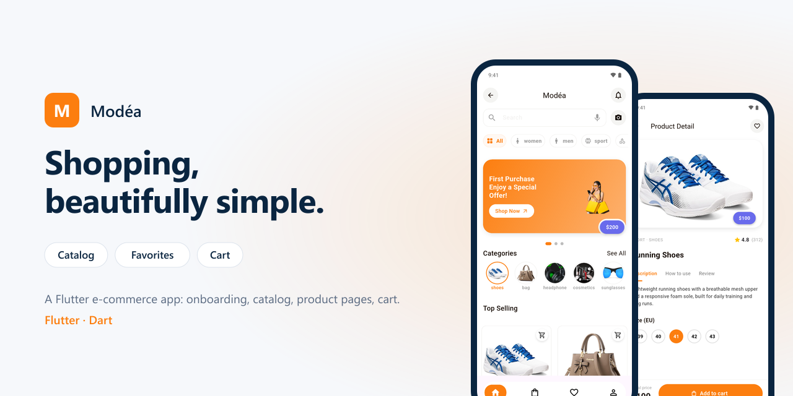
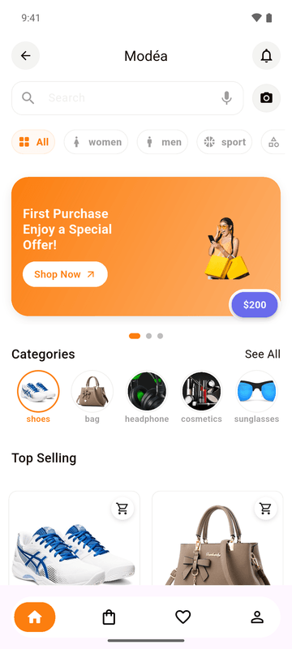
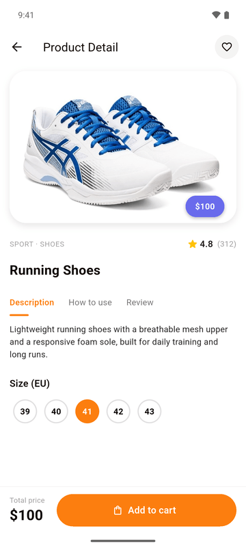
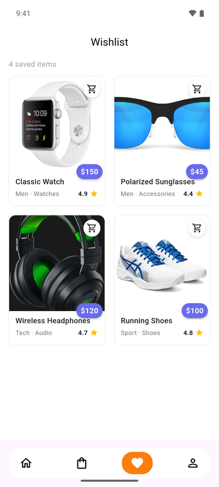
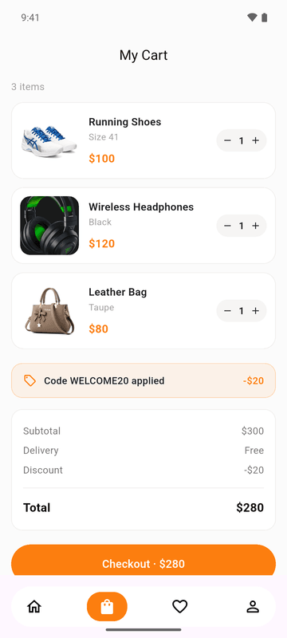
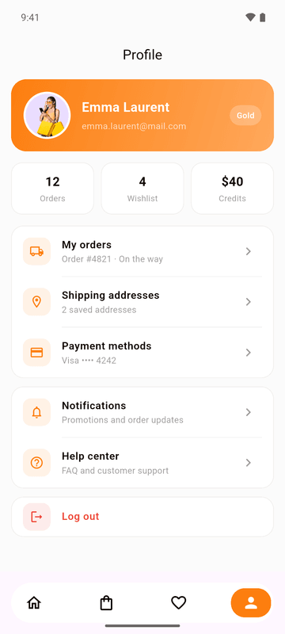

# Modéa

<p align="center"></p>


A Flutter fashion e-commerce app: onboarding, product catalog, product pages, favorites and cart.

## Screens

<p align="center"></p>

| Onboarding | Home | Product |
|:---:|:---:|:---:|
|  |  |  |

| Favorites | Cart | Profile |
|:---:|:---:|:---:|
|  |  |  |

## Features

- **Onboarding**: introduction slides on first launch.
- **Sign in and sign up**: forms with social sign-in buttons.
- **Catalog**: search, category filters, promotional banner and top-selling products.
- **Product page**: rating, description, usage and reviews tabs, size selection, add to cart.
- **Cart**: quantities, promo code, order summary and checkout, with a payment confirmation screen.
- **Favorites**: products saved for later.
- **Profile**: orders, shipping addresses, payment methods and notification settings.

## Tech stack

- Flutter, Dart
- [google_nav_bar](https://pub.dev/packages/google_nav_bar), [onboarding](https://pub.dev/packages/onboarding), [flutter_svg](https://pub.dev/packages/flutter_svg), [font_awesome_flutter](https://pub.dev/packages/font_awesome_flutter)

```
lib/
├── constants/    colors, text styles
├── data/         product catalog
├── navigation/   bottom navigation
├── screens/      start, auth, home, shop, product_detail, favorite, profile
└── ui/           reusable widgets
```

## Getting started

```bash
flutter pub get
flutter run
```

## Status and roadmap

The catalog is local (`lib/data/products.dart`). Next steps:

- [ ] REST API for products, accounts and orders
- [ ] Real payment integration
- [ ] Order tracking

## License

MIT, see [LICENSE](LICENSE).

## Author

**Dissang Kevin** · Mobile AI Engineer
[Portfolio](https://dissangkevin.work) · [GitHub](https://github.com/kteken10)
